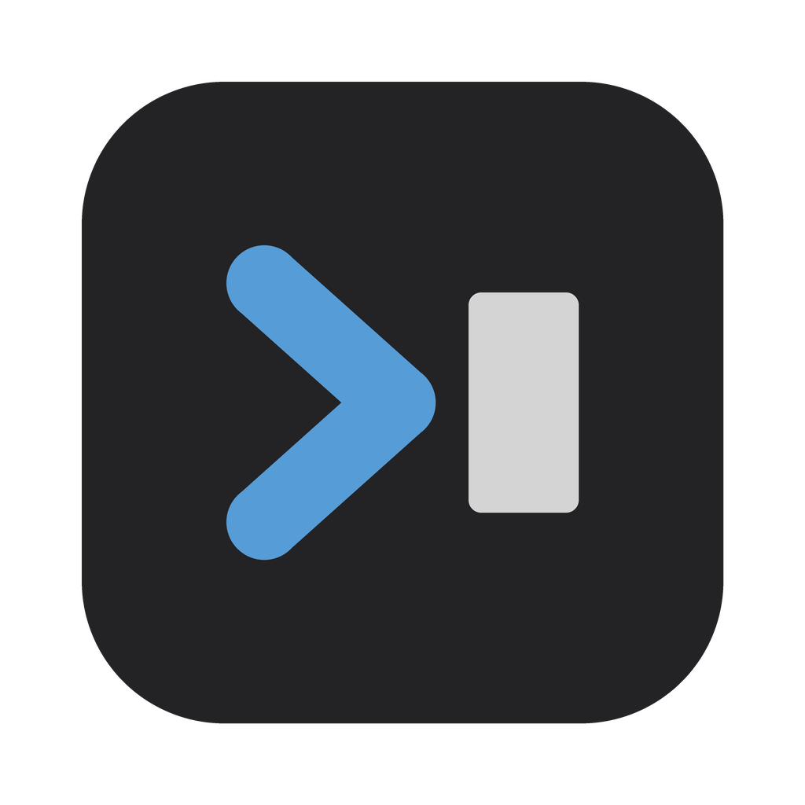

<p align="center">
  
</p>

<h1 align="center">Rift</h1>

<p align="center">
  <a href="https://github.com/botjaeger/rift">github.com/botjaeger/rift</a> ·
  <a href="https://github.com/botjaeger/rift-releases/releases">Releases</a> ·
  <a href="docs/README.md">Documentation</a>
</p>

A GPU-accelerated terminal for macOS and Linux that turns every command into a
**block** — its command, output, exit status and duration in one unit you can
select, copy, search, bookmark, re-run or send to another command.

Rust · wgpu · glyphon · winit · alacritty_terminal. No account, no cloud, no
telemetry, no AI features: a local terminal configured with one TOML file.


## Why Rift

- **Output has structure.** A classic terminal is one long scroll. Rift
  knows where each command starts and ends (shell integration, OSC 133), so
  "copy the output of that failed build" or "jump to the last error" is one
  keystroke.
- **The command line is a real editor.** Syntax highlighting, completions with
  descriptions, multi-line editing, undo, and optional vim keys — before the
  shell sees anything.
- **Full terminal underneath.** vim, tmux, htop, ssh and every TUI run
  unchanged: Rift hands the keyboard straight to the program whenever one is
  running.
- **Warp's habits without Warp's account.** Warp's default keys, and its
  theme and launch-configuration files work unchanged; profiles, actions and
  kept exited panes work as in Windows Terminal.
- **Modern protocols.** Kitty keyboard and graphics, iTerm2 images,
  synchronized output, OSC 8 links, OSC 52 clipboard, bracketed paste,
  notifications (OSC 9/777/99).
- **Fast and small.** One binary with embedded fonts, themes and shell hooks.
  GPU rendering with a shaped-text cache; 500,000 lines of output render in
  0.54 s with a 138 MiB peak ([baseline](docs/performance.md)).

## Features

Shortcuts are macOS defaults; on Linux, ⌘ is the Super key and most actions
also have a ⌃⇧ chord. Every action is in the command palette (⌘P) and can be
rebound. Full list: [keyboard shortcuts](docs/keyboard-shortcuts.md).

| Feature | How to use it |
|---|---|
| **Command blocks** — header with command, directory, git branch, exit badge, duration | Automatic in zsh, bash and fish. Select with ⌘↑ / ⌘↓ or a click |
| Copy a block's command / output | ⇧⌘C / ⌥⇧⌘C, or the copy button that appears when you hover the header |
| Exact run time of a block | Hover its duration: how long it took and when it finished |
| Block menu — copy, re-run, bookmark, collapse, filter, send output, copy as HTML or Markdown, save output | Right-click a block, or ⌃M |
| Bookmarks | ⌘B marks a block; ⇧⌘↑ / ⇧⌘↓ jump between marks |
| Filter a block's output — text or regex, match case, invert, context lines | ⌥⇧F, then type: only matching lines stay visible |
| Several blocks at once — copy, insert, bookmark, collapse | ⌘-click blocks (⇧-click a range), then the block menu |
| Compare two outputs as a line diff | Two selected blocks → *Compare outputs*, or block menu → *Compare with previous run* |
| Save output or the whole buffer to a file | Block menu → *Save output…*; right-click the terminal → *Export buffer…* |
| Send block output to a command | Block menu → *Send output to command…*: runs `cmd < output` without pasting it |
| Clear | `clear` hides old output but keeps it; ⌘K wipes blocks and scrollback |
| **Command editor** — highlighting, ghost suggestions, completion menu | Type at the prompt; Tab accepts, ⌃→ accepts one word |
| Multi-line commands | ⇧⏎ adds a line, ⏎ runs |
| History search; its Results tab searches past output (`is:failed`, `since:7d`, `host:`, `dir:`) | ⌃R |
| Vim keys in the editor, with registers | Settings → Input → *Vim keybindings*; `vim_clipboard = "unnamed"` shares the clipboard |
| Compose a long prompt for a coding agent or any full-screen program | ⌃⇧G or ⌘E |
| Smart selection — a URL, path, email, IP, hash or UUID whole | Double-click |
| Fonts — embedded JetBrains Mono and Hack, or any installed monospace font (Menlo, Monaco, SF Mono…) | Settings → Appearance → *Font family* (each previewed in itself) |
| **Command palette** — every action, setting, theme, launch config | ⌘P |
| Find in scrollback (case and regex toggles), or inside one block | ⌘F; with a block selected it searches that block |
| Select scrollback from the keyboard (mark mode) | ⇧⌘M |
| Several carets in the command editor | ⌃⇧↑ / ⌃⇧↓, ⌃G next occurrence, ⌘-click |
| What each part of a command is (command inspector) | ⇧⌘I, or rest the pointer on it |
| **Tabs and split panes** | ⌘T tab, ⌘D split right, ⇧⌘D split down, ⌥⌘arrows move, ⇧⌘⏎ zoom |
| Profiles — a program, arguments, folder, environment, title, colour and theme per tab | `[[profiles]]` in config.toml; the ⌄ beside + or ⌃⇧1…9 |
| Your own actions — Rift actions, typed text and launch configurations in one step | `[[actions]]` in config.toml; palette → *Action: name*, or its chord |
| Tab groups and pinned tabs | Right-click a tab → *Pin tab* / *Group tab*; ⌘-click tabs first to group several |
| Tab colours — any hex, cycled, or by folder | Right-click a tab → a colour or *Custom color…*; `[[tab_color_rules]]` |
| Vertical tabs — a rail listing every pane with its folder, branch and changes, searchable | Settings → Appearance → *Tab position: Side*, or palette → *Toggle vertical tabs*; ⇧⌘F searches |
| Read-only panes, restart a pane | Right-click the terminal → *Make read-only* / *Restart pane* |
| Keep a pane after its shell exits, with a Restart button | `close_on_exit = "never"` (or `"graceful"`) |
| A colour scheme per pane | Palette → *Pane theme: name*, or `theme` in a profile |
| Session switcher (tabs, panes, other windows, recent blocks) | ⇧⌘O |
| Hint mode (open or copy visible links, paths, blocks by letter) | ⇧⌘H |
| Synchronized input to every pane of a tab | ⌥⌘I |
| Notifications — finished and failed commands, Claude Code / Codex and program notifications, password prompts; toasts, sounds per event | ⇧⌘A or the inbox button at the top right; Settings → Notifications |
| **File explorer** — the project tree with git status, a read-only file viewer that renders Markdown | ⇧⌘E or the sidebar button next to the traffic lights; click a file to view it, ⌥-click to insert its path, right-click to copy its path, add a file or reveal it |
| Run a Markdown shell block, or open a printed `.md` file in the viewer | The code block's *Run…* button (asks first); block menu → *Open in viewer* after `cat file.md` |
| **Code review** — staged and unstaged diffs; stage, unstage or revert a file or hunk; commit and push | ⇧⌘G or the `± +N −M` button at the top right |
| Send code to a coding agent in another pane | Review panel or file viewer → *Send to agent…* |
| Session restore (tabs, splits, directories, window position) | On by default (`restore_session`) |
| Saved block output across restarts | Settings → General → *Save block output for restore* |
| Durable sessions (the main window's shells keep running through an update or a crash; quitting ends them and the next launch starts fresh) | On by default with *Restore tabs after a crash*; Settings → General → *Keep shells running through updates* |
| Updates — checked at launch and every 6 hours; tabs and running shells survive the restart | *Update Rift* in the tab bar; Settings → About; Settings → General → *Check for updates* |
| Links and paths | ⌘-click URLs, OSC 8 links and file paths (`file:line:col`, `file(line,col)`, Python tracebacks too); right-click one to open, copy or reveal it; Settings → Files picks the editor they open in |
| Links back to a pane — `RIFT_PANE_URL` in every shell focuses its pane | `open "$RIFT_PANE_URL"`, e.g. from a Claude Code hook or an ntfy click |
| Terminal behavior — mouse reporting, middle-click paste, wheel speed, OSC 52 clipboard access, Option as Meta | Settings → Terminal |
| Coding agents — Claude Code / Codex tabs spin only while the agent works; ⌘⌫ clears its input line | Automatic |
| Inline images (kitty graphics, iTerm2) | Automatic: `kitten icat`, `imgcat`, `timg`, `yazi`, `chafa` |
| Paste safety | A multi-line paste into a program without bracketed paste asks before running it; `large_paste_warning` asks before a large paste, `trim_paste` drops trailing newlines |
| Secret masking — keys and tokens hidden on screen, in copies, exports, search and notifications | `mask_secrets = true`, or palette → *Toggle secret masking* |
| Progress reports (OSC 9;4) | Automatic: a bar under the tab, and the Dock icon badge on macOS |
| SSH profiles with remote blocks | Palette → *SSH: host*; *Install Rift shell integration on host* once |
| Automation socket | `rift-terminal ctl list`, `focus`, `blocks`, `split`, `open`, `send-text` |
| Phone companion | Settings → *Remote access*: pair an iPhone or Android phone by QR code, follow panes live, run commands and send Ctrl-C from it; end-to-end encrypted, directly on your network, or from anywhere through Rift's relay (or your own) that only sees ciphertext (app in `mobile/`) |
| Themes — 13 built in, your TOML or Warp YAML (gradients too), OS light/dark sync | Settings → Themes, palette → *Theme picker (live preview)*, or `~/.config/rift/themes/` |
| Text and cursor — font weight, OpenType features, minimum contrast, bold is bright; block, bar, underline, hollow or double underline cursor | Cursor: Settings → Appearance; text: `font_weight`, `font_features`, `minimum_contrast`, `bold_is_bright` in config.toml |
| Window — padding per side, default size, maximized or fullscreen launch, always on top, named windows, snap to cells | Settings → Appearance; palette → *Toggle always on top*, *Rename window* |
| Launch configurations (Warp YAML) | Palette → *Launch configuration: name* |
| Alert when a long command finishes out of view (toast, or desktop notification in the background) | On by default, after 10 s; `request_attention` also bounces the Dock icon on a bell |
| Screen readers (VoiceOver, Orca) | Automatic (AccessKit) |
| Global hotkey to show or hide Rift, or a drop-down window from any screen edge | `global_hotkey = "alt+space"` in config.toml; Settings → General → *Drop-down hotkey window*, `hotkey_window_edge` |
| The `rift` command (`rift .` opens a folder in Rift) | Palette → *Install 'rift' command* |

Behavior details: [features](docs/features.md) · every screen:
[UI](docs/ui.md) · first steps: [getting started](docs/getting-started.md).

## Install

Prebuilt packages are attached to each
[release](https://github.com/botjaeger/rift-releases/releases). The app
from the DMG (in a writable folder such as Applications) and the AppImage
update themselves: *Update Rift* appears in the tab bar when a new release
is out, and updating keeps your tabs and running shells.

**macOS** — download `Rift-<version>-<arch>.dmg` (`arm64` for Apple silicon,
`x86_64` for Intel), open it and drag Rift to Applications. The bundle is
ad-hoc signed, not notarized, so macOS refuses the first launch ("Apple could
not verify “Rift”"). Allow it once: click *Done*, then System Settings →
Privacy & Security → *Open Anyway*, or run
`xattr -dr com.apple.quarantine /Applications/Rift.app`. Updates installed
from inside Rift need neither.

**Debian / Ubuntu** — download `rift-terminal_<version>_amd64.deb`:

```sh
sudo dpkg -i rift-terminal_<version>_amd64.deb
sudo apt-get install -f        # only if dpkg reports missing dependencies
```

**AppImage** (any distribution):

```sh
chmod +x Rift-<version>-x86_64.AppImage
./Rift-<version>-x86_64.AppImage
```

AppImages need FUSE 2, which Ubuntu 24.04 no longer installs. If you see
`Cannot mount AppImage, please check your FUSE setup`, run
`sudo apt install libfuse2t64`, or start it with
`--appimage-extract-and-run`.

**Tarball** — `rift-terminal-<version>-<os>-<arch>.tar.gz` (`macos-arm64`,
`macos-x86_64`, `linux-x86_64`) holds the binary,
the `.desktop` file, the icon and `docs/`; put `rift-terminal` on your
`PATH`.

## Quick start

1. Open Rift. Your login shell (`$SHELL`) starts with Rift's integration
   loaded — nothing to add to your rc files.
2. Type a command and press ⏎. It becomes a block.
3. Press ⌘↑ to select it, ⌥⇧⌘C to copy its output, ⌘P to see every action.
4. Change settings with ⌘, — they are saved to `~/.config/rift/config.toml`
   and apply instantly. Editing the file by hand works too.

More in [getting started](docs/getting-started.md).

## Requirements

To run a release:

- **macOS** 11 or newer (Apple silicon or Intel).
- **Linux** x86_64 with a Vulkan, OpenGL or software (Mesa) GPU driver, on
  X11 or Wayland.
- A shell: zsh, bash or fish. Command blocks need one of these; any other
  shell still runs as a plain terminal.

Windows is not supported yet.

To build from source, additionally:

- [rustup](https://rustup.rs). It installs the pinned Rust 1.98.0 (with
  rustfmt and clippy) from `rust-toolchain.toml` on first use.
- macOS: Xcode Command Line Tools (`xcode-select --install`).
- Linux (Debian/Ubuntu names): `libxkbcommon-dev libwayland-dev libxcb1-dev
  libxcb-render0-dev libxcb-shape0-dev libxcb-xfixes0-dev pkg-config`.
- For the quality gates: `python3` (the test gate's release-manifest
  self-test and the scripted UI checks), `shellcheck`, `zsh`, `fish`,
  Node 22 with pnpm (`corepack enable`; the mobile gate), and Docker (Linux
  gate).

## Start, stop, clean

```sh
git clone https://github.com/botjaeger/rift.git
cd rift

cargo run                              # start: debug build, then launch
cargo run --release                    # start: optimized build
cargo build --release                  # binary only: target/release/rift-terminal
packaging/make-app.sh                  # macOS app bundle: target/Rift.app
```

**Stop** — quit with ⌘Q (Linux: Super+Q) or close the last window: every
shell ends and the next launch starts fresh. ⌃C in the terminal that ran
`cargo run` (or a crash) stops only the window: with durable sessions on (the
default; Settings → General) and *Restore tabs after a crash* on (also the
default), the main window's shells keep running in the background session
service, which exits by itself 10 s after its last shell is closed, and the
next launch reattaches them.

**Clean** — build output lives only in `target/`:

```sh
cargo clean                            # delete target/ (all builds, packages, test artifacts)
docker rmi rift-linux-verify rift-ci-ubuntu  # Linux gate images, if you ran it
docker volume rm rift-cargo-registry  # Linux gate crate cache
```

Rift keeps your settings in `~/.config/rift/` and its session, shell
integration and saved output in `~/.local/share/rift/`. Delete those two
directories only to reset Rift completely — this removes your settings,
themes and launch configurations.

Packages (`.dmg`, `.deb`, AppImage, tarball) and releases:
[development guide](docs/development.md#packaging-and-releases).

## Test

```sh
scripts/gates.sh          # fmt, clippy, tests, rustdoc, shell hooks, docs, mobile app
scripts/gates.sh ui       # scripted UI regressions in an isolated instance
scripts/gates.sh all      # also a release build, the UI checks and the Linux gate in docker
cargo test --workspace    # unit tests only
```

CI runs the same script. Rendering is verified with the scripted UI driver
(`rift-terminal --script`, with `--headless` for a run that never shows a
window or takes focus), described in the
[development guide](docs/development.md#verifying-ui-changes).

## Documentation

Start at the [documentation index](docs/README.md).

| Document | Contents |
|---|---|
| [Getting started](docs/getting-started.md) | First run and everyday use |
| [Features](docs/features.md) | Every feature and its exact behavior |
| [UI](docs/ui.md) | Every screen and control |
| [Keyboard shortcuts](docs/keyboard-shortcuts.md) | Full keymap and how to rebind it |
| [Configuration](docs/configuration.md) | `config.toml`, themes, launch configs, file locations |
| [Development](docs/development.md) | Build, test, gates, dependencies, architecture, releases |
| [Design](DESIGN.md) | Design tokens, metrics and visual rules |
| [Performance](docs/performance.md) | Benchmark harness and baseline |
| [Roadmap](docs/terminal-landscape-roadmap.md) | What is done and what is next |
| [Agent guide](CLAUDE.md) | For coding agents (`CLAUDE.md` = `AGENTS.md`): commands, invariants, safety |
| [Changelog](CHANGELOG.md) | Release notes |

## License

[MIT](LICENSE) © 2026 botjaeger.
