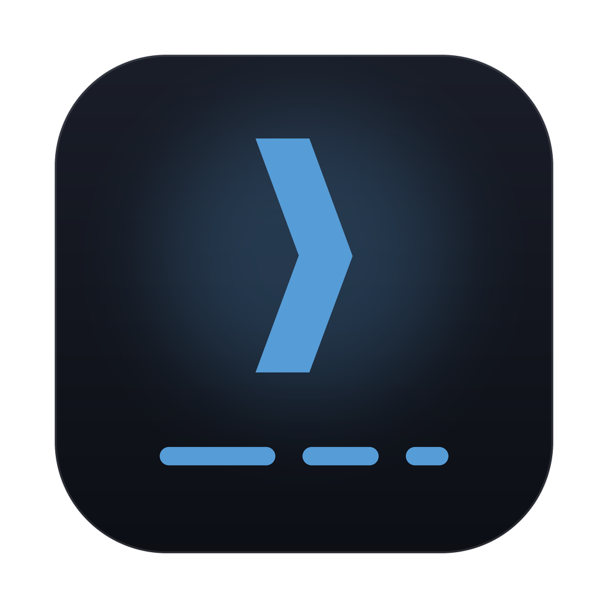
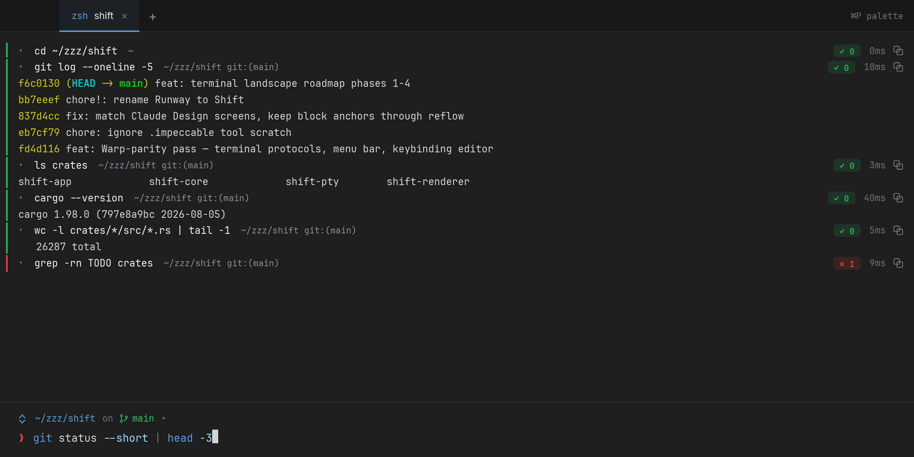

# Shift

A GPU-accelerated terminal for macOS and Linux that turns every command into a
**block** — its command, output, exit status and duration in one unit you can
select, copy, search, bookmark, re-run or send to another command.

Rust · wgpu · glyphon · winit · alacritty_terminal. No account, no cloud, no
telemetry, no AI features: a local terminal configured with one TOML file.



## Why Shift

- **Output has structure.** A classic terminal is one long scroll. Shift
  knows where each command starts and ends (shell integration, OSC 133), so
  "copy the output of that failed build" or "jump to the last error" is one
  keystroke.
- **The command line is a real editor.** Syntax highlighting, completions with
  descriptions, multi-line editing, undo, and optional vim keys — before the
  shell sees anything.
- **Full terminal underneath.** vim, tmux, htop, ssh and every TUI run
  unchanged: Shift hands the keyboard straight to the program whenever one is
  running.
- **Warp's workflow without Warp's account.** Warp's default keys, and its
  theme, workflow and launch-configuration files work unchanged.
- **Modern protocols.** Kitty keyboard and graphics, iTerm2 images,
  synchronized output, OSC 8 links, OSC 52 clipboard, bracketed paste,
  notifications (OSC 9/777/99).
- **Fast and small.** One binary with embedded fonts, themes and shell hooks.
  GPU rendering with a shaped-text cache; 500,000 lines of output render in
  0.66 s using 191 MB ([baseline](docs/performance.md)).

## Features

Shortcuts are macOS defaults; on Linux, ⌘ is the Super key and most actions
also have a ⌃⇧ chord. Every action is in the command palette (⌘P) and can be
rebound. Full list: [keyboard shortcuts](docs/keyboard-shortcuts.md).

| Feature | How to use it |
|---|---|
| **Command blocks** — header with command, directory, git branch, exit badge, duration | Automatic in zsh, bash and fish. Select with ⌘↑ / ⌘↓ or a click |
| Copy a block's command / output | ⇧⌘C / ⌥⇧⌘C, or the copy button on the header |
| Block menu — copy, re-run, bookmark, collapse, filter, send output | Right-click a block, or ⌃M |
| Bookmarks | ⌘B marks a block; ⇧⌘↑ / ⇧⌘↓ jump between marks |
| Filter a block's output | ⌥⇧F, then type: only matching lines stay visible |
| Send block output to a command | Block menu → *Send output to command…*: runs `cmd < output` without pasting it |
| Clear | `clear` hides old output but keeps it; ⌘K wipes blocks and scrollback |
| **Command editor** — highlighting, ghost suggestions, completion menu | Type at the prompt; Tab accepts, ⌃→ accepts one word |
| Multi-line commands | ⇧⏎ adds a line, ⏎ runs |
| History search | ⌃R |
| Workflows (saved commands with `{{placeholders}}`) | ⌃⇧R; Tab moves between placeholders |
| Vim keys in the editor | Settings → Features → *Vim keybindings* |
| **Command palette** — every action, setting, theme, launch config | ⌘P |
| Find in scrollback (case and regex toggles) | ⌘F |
| **Tabs and split panes** | ⌘T tab, ⌘D split right, ⇧⌘D split down, ⌥⌘arrows move, ⇧⌘⏎ zoom |
| Vertical tabs | Settings → Appearance → *Tabs: Side*, or palette → *Toggle vertical tabs* |
| Session switcher (tabs, panes, other windows, recent blocks) | ⇧⌘O |
| Hint mode (open or copy visible links, paths, blocks by letter) | ⇧⌘H |
| Synchronized input to every pane of a tab | ⌥⌘I |
| Notifications — finished and failed commands, Claude Code / Codex and program notifications, password prompts; toasts, sounds per event | ⇧⌘A or the inbox button at the top right; Settings → Notifications |
| **File explorer** — the project tree with git status, a read-only file viewer | ⇧⌘E or the sidebar button next to the traffic lights; click a file to view it, ⌥-click to insert its path |
| **Code review** — staged and unstaged diffs; stage, unstage or revert a file or hunk | ⇧⌘G or the `± +N −M` button at the top right |
| Session restore (tabs, splits, directories, window position) | On by default (`restore_session`) |
| Saved block output across restarts | Settings → General → *Save block output for restore* |
| Durable sessions (shells keep running after you quit) | Settings → General → *Keep shells running when Shift quits* |
| Links and paths | ⌘-click URLs, OSC 8 links and file paths (`file:line:col` too) |
| Inline images (kitty graphics, iTerm2) | Automatic: `kitten icat`, `imgcat`, `timg`, `yazi`, `chafa` |
| Paste safety | Multi-line paste into a shell asks before running |
| SSH profiles with remote blocks | Palette → *SSH: host*; *Install Shift shell integration on host* once |
| Automation socket | `shift-terminal ctl list`, `focus`, `split`, `open`, `send-text` |
| Themes — 4 built in, your TOML or Warp YAML, OS light/dark sync | Settings → Themes, or `~/.config/shift/themes/` |
| Launch configurations (Warp YAML) | Palette → *Launch configuration: name* |
| Alert when a long command finishes out of view (toast, or desktop notification in the background) | On by default, after 10 s |
| Screen readers (VoiceOver, Orca) | Automatic (AccessKit) |
| Global hotkey to show or hide Shift | `global_hotkey = "alt+space"` in config.toml |

Behavior details: [features](docs/features.md) · every screen:
[UI](docs/ui.md) · first steps: [getting started](docs/getting-started.md).

## Install

Prebuilt packages are attached to each [release](../../releases).

**macOS** — download `Shift-<version>-<arch>.dmg` (`arm64` for Apple silicon,
`x86_64` for Intel), open it and drag Shift to Applications. The bundle is
ad-hoc signed, so the first launch needs *right-click → Open* once.

**Debian / Ubuntu** — download `shift-terminal_<version>_amd64.deb`:

```sh
sudo dpkg -i shift-terminal_<version>_amd64.deb
sudo apt-get install -f        # only if dpkg reports missing dependencies
```

**AppImage** (any distribution):

```sh
chmod +x Shift-<version>-x86_64.AppImage
./Shift-<version>-x86_64.AppImage
```

AppImages need FUSE 2, which Ubuntu 24.04 no longer installs. If you see
`Cannot mount AppImage, please check your FUSE setup`, run
`sudo apt install libfuse2t64`, or start it with
`--appimage-extract-and-run`.

**Tarball** — `shift-terminal-<version>-<os>-<arch>.tar.gz` holds the binary,
the `.desktop` file, the icon and `docs/`; put `shift-terminal` on your
`PATH`. The binary is not called `shift` because `shift` is a shell builtin.

## Quick start

1. Open Shift. Your login shell (`$SHELL`) starts with Shift's integration
   loaded — nothing to add to your rc files.
2. Type a command and press ⏎. It becomes a block.
3. Press ⌘↑ to select it, ⌥⇧⌘C to copy its output, ⌘P to see every action.
4. Change settings with ⌘, — they are saved to `~/.config/shift/config.toml`
   and apply instantly. Editing the file by hand works too.

More in [getting started](docs/getting-started.md).

## Build from source

Requirements:

- Rust 1.98.0 — `rustup` installs it automatically from `rust-toolchain.toml`.
- macOS 11+ with Xcode Command Line Tools, or Linux with a Vulkan, GL or
  Wayland/X11 GPU driver.
- Linux build packages: `libxkbcommon-dev libwayland-dev libxcb1-dev
  libxcb-render0-dev libxcb-shape0-dev libxcb-xfixes0-dev libssl-dev
  pkg-config`.

```sh
cargo run -p shift-app                 # debug build and launch
cargo build --release                  # target/release/shift-terminal
packaging/make-app.sh                  # macOS: target/Shift.app
```

Packages (`.dmg`, `.deb`, AppImage, tarball) and releases:
[development guide](docs/development.md#packaging-and-releases).

## Test

```sh
scripts/gates.sh          # fmt, clippy, tests, rustdoc, shell hooks, docs
scripts/gates.sh all      # also a release build and the Linux gates in docker
cargo test --workspace    # unit tests only
```

CI runs the same script. Rendering is verified with the scripted UI driver
(`shift-terminal --script`), described in the
[development guide](docs/development.md#verifying-ui-changes).

## Documentation

| Document | Contents |
|---|---|
| [Getting started](docs/getting-started.md) | First run and everyday use |
| [Features](docs/features.md) | Every feature and its exact behavior |
| [UI](docs/ui.md) | Every screen and control |
| [Keyboard shortcuts](docs/keyboard-shortcuts.md) | Full keymap and how to rebind it |
| [Configuration](docs/configuration.md) | `config.toml`, themes, workflows, launch configs, file locations |
| [Development](docs/development.md) | Build, test, gates, dependencies, architecture, releases |
| [Design](DESIGN.md) | Design tokens, metrics and visual rules |
| [Performance](docs/performance.md) | Benchmark harness and baseline |
| [Roadmap](docs/terminal-landscape-roadmap.md) | What is done and what is next |

## License

[MIT](LICENSE) © 2026 botjaeger.
